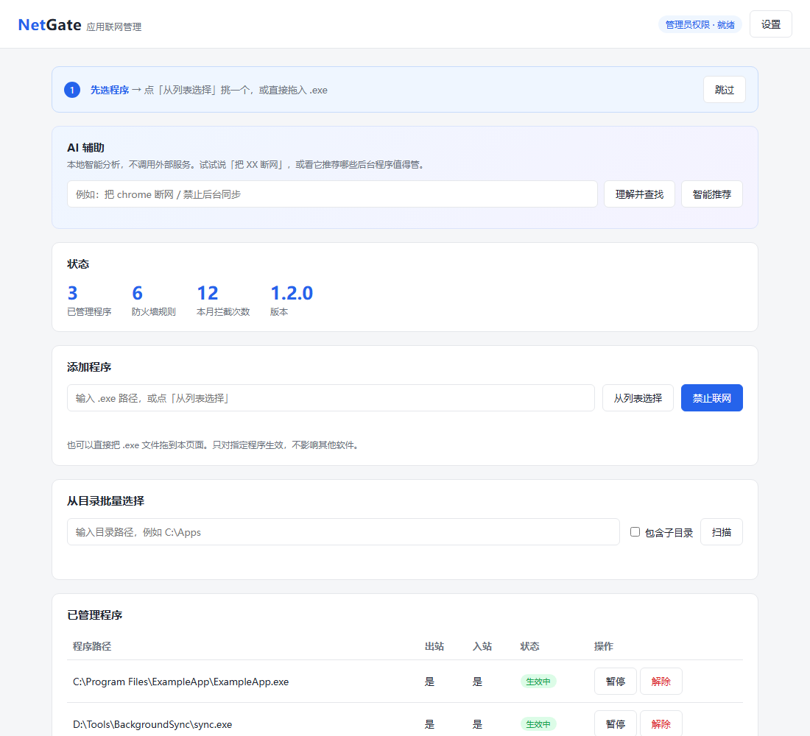

# NetGate

[](LICENSE)
[](https://www.microsoft.com/windows)
[](https://learn.microsoft.com/powershell/)
[](https://github.com/jiucheng-lin/netgate/stargazers)

> 一个通用的 Windows 应用联网管理工具。给单个程序单独断网，不影响系统和其他软件。

**NetGate 不内置任何软件名单，不针对任何特定厂商或产品。** 要管哪个程序，完全由你自己指定。

## 它解决什么问题

- 某个游戏/软件在后台偷跑流量、自动更新、偷偷上传——单独把它断网
- 想给孩子的具体某个程序设限，而不是整台机器断网
- 测试环境里需要隔离某个程序的网络访问
- 临时禁用某软件联网，随时一键恢复，不用改系统设置

## 界面



> 截图占位：`docs/screenshot.png`。你可以运行 `START.bat` 后自行截图替换。

## 特性

- **按程序管理**：只对你指定的 `.exe` 生效，不影响其他软件
- **程序选择器**：自动列出正在运行和已安装的程序，点选即可，不用手打路径
- **拖拽添加**：直接把 `.exe` 拖到页面上
- **双向拦截**：出站 + 入站规则同时生效
- **批量操作**：扫描整个目录，勾选多个程序一起处理
- **随时暂停/恢复**：规则可临时停用，不必删了重建
- **配置可迁移**：导出 JSON 备份，换机器导入即用
- **本地 Web 界面**：浏览器操作，无需记命令行
- **命令行支持**：所有操作都有对应命令，方便脚本化
- **干净卸载**：一键清除只删自己建的 `NG-` 前缀规则，不碰系统其他规则
- **零依赖**：纯 PowerShell + 一个 HTML 页面，不用装任何东西
- **可选匿名统计**：默认关闭，用户明确同意后才启用（见下方隐私说明）

## 快速开始

1. 下载本仓库（Code → Download ZIP）并解压
2. 双击 `START.bat`，UAC 弹窗点「是」
3. 浏览器自动打开 `http://127.0.0.1:8765`
4. 填入一个 `.exe` 的完整路径，点「禁止联网」

> 修改防火墙规则需要管理员权限，所以脚本会自提权。那个黑色命令行窗口要保持打开，关掉即停止服务。

命令行方式：

```powershell
.\netgate.ps1 -Action block -Path "C:\Apps\example.exe"
.\netgate.ps1 -Action list
.\netgate.ps1 -Action unblock -Path "C:\Apps\example.exe"
```

更多命令见 [README 命令行章节](#命令行)。

## 安全与隐私

- 服务只监听 `127.0.0.1`（本机回环），局域网和公网都访问不到
- **匿名统计默认关闭**：首次运行会询问，选「不用，谢谢」即完全不记录；随时可在「设置」里关闭并清除本地数据
- 统计只上报功能使用次数（事件名 + 成功/失败 + 粗略系统版本 + 随机匿名 ID），**不含**程序路径、文件名、用户名、机器名或 IP
- 规则名用路径哈希生成（纯 ASCII），原路径存在本地防火墙规则的 Description 字段里
- 全部代码开源可审计，无任何第三方依赖

**合法使用**：NetGate 是一个通用的网络访问管理工具，用于合法的流量管控和程序隔离。请勿用于规避软件授权机制、侵犯版权或任何违法用途。作者不对使用者的行为负责。

## 文档

- [README.md](README.md) — 本文档
- [CONTRIBUTING.md](CONTRIBUTING.md) — 贡献指南
- [examples/rules.example.json](examples/rules.example.json) — 配置示例
- [docs/TELEMETRY.md](docs/TELEMETRY.md) — 遥测设计说明（默认关闭）
- [docs/DEPLOY-ANALYTICS.md](docs/DEPLOY-ANALYTICS.md) — 部署统计后端（Cloudflare Worker）
- [ops/repo-stats.ps1](ops/repo-stats.ps1) — 仓库运营数据报告脚本
- [worker/](worker/) — 匿名统计收集端（Cloudflare Worker + KV）

### 运营数据

维护者可用以下命令拉取仓库的 star/fork/下载量/流量数据：

```powershell
.\ops\repo-stats.ps1 -Repo jiucheng-lin/netgate -OutFile .\analytics.md
```

需要本机已登录 `gh auth login`。报告只含仓库级公开指标，不含用户使用数据。

## 技术栈

| 组件 | 技术 |
|---|---|
| 核心逻辑 | Windows PowerShell 5.1+ |
| Web 服务 | .NET TcpListener（仅回环地址） |
| 前端 | 原生 HTML/CSS/JavaScript，无框架 |
| 防火墙 | Windows Defender Firewall API |

## License

[MIT](LICENSE) — 可自由使用、修改、分发，保留版权声明即可。
